# Deep Learning — Practical Report 4 (PR 4)
## Project A: CNN from Scratch — CIFAR-10 Image Classifier

[](https://www.tensorflow.org/)
[](https://keras.io/)
[](https://www.python.org/)
[](LICENSE)

---

## 📌 Project Declaration
- **Student Name:** [Your Name]
- **Enrolment / GRID:** [Your GRID / Roll Number]
- **Subject:** Deep Learning (Practical Report 4 - PR 4)
- **Chosen Project:** **Project A — CNN from Scratch: CIFAR-10 Image Classifier**
- **Primary Deliverables:** 
  - [`DL_PR4A.ipynb`](DL_PR4A.ipynb) (Executed Jupyter Notebook)
  - [`DL_PR4A.html`](DL_PR4A.html) (HTML Report Export)
  - [`plots/`](plots/) (High-resolution analytical figures & charts)
  - [`requirements.txt`](requirements.txt) (Python environment dependencies)

---

## 📊 Dataset Overview: CIFAR-10
CIFAR-10 (*Canadian Institute For Advanced Research*) is a standard computer vision benchmark comprising $60,000$ $32 \times 32$ color images across 10 mutually exclusive categories:

| Class ID | Category Name | Training Images | Test Images | Distinctive Visual Features |
|:---:|:---:|:---:|:---:|:---|
| 0 | Airplane | 5,000 | 1,000 | High aspect-ratio wings, metallic body, sky backgrounds |
| 1 | Automobile | 5,000 | 1,000 | Rectangular profiles, rubber wheels, road/asphalt contexts |
| 2 | Bird | 5,000 | 1,000 | Feathered textures, beaks, tree/perch backgrounds |
| 3 | Cat | 5,000 | 1,000 | Quadruped, fur textures, domestic indoor settings |
| 4 | Deer | 5,000 | 1,000 | Antlers, slender limbs, forest/grassland environments |
| 5 | Dog | 5,000 | 1,000 | Quadruped, floppy/pointed ears, snout, outdoor/domestic |
| 6 | Frog | 5,000 | 1,000 | Amphibian skin texture, bulbous eyes, swamp/greenery |
| 7 | Horse | 5,000 | 1,000 | Long muzzle, mane, equine torso, open pasture |
| 8 | Ship | 5,000 | 1,000 | Elongated hulls, superstructures, water/ocean contexts |
| 9 | Truck | 5,000 | 1,000 | Heavy cab and cargo bed, vertical grilles, highway contexts |

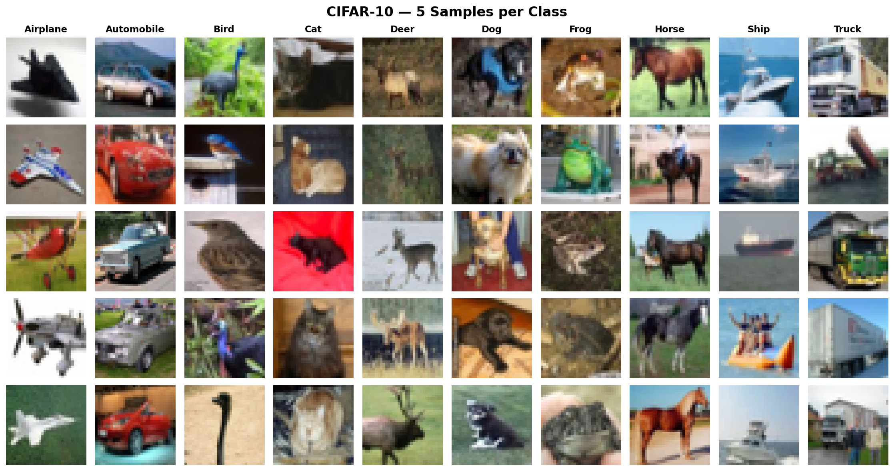
*Figure 1: 5 Representative samples per class across all 10 CIFAR-10 categories.*

---

## 🧠 Comprehensive Topic Descriptions & Theoretical Foundations

### 1. CNN History vs ANN for Image Classification
- **ANN (MLP) Flaws in Vision:** Multilayer Perceptrons require unrolling an image into a flat 1D vector ($32 \times 32 \times 3 = 3,072$ inputs). This vectorization destroys all 2D geometric topology. An MLP is completely invariant to spatial permutations: if all pixels in the training set are randomly permuted identically, an MLP learns with identical loss, demonstrating total blindness to spatial coherence. Moreover, fully connecting $3,072$ inputs to a first hidden layer of $1,024$ neurons requires **$3,146,752$ weights**, leading to immediate overfitting.
- **CNN Architectural Advantages:**
  - *Spatial Preserving Tensors:* Operates on rank-3 tensors $(H, W, C)$, preserving spatial adjacency.
  - *Local Receptive Fields & Translation Invariance:* Shared convolutional kernels scan the entire image, detecting patterns regardless of spatial translation.
  - *Weight Sharing Efficiency:* A $3 \times 3 \times 3$ filter contains only **28 parameters**, shared across all spatial positions.

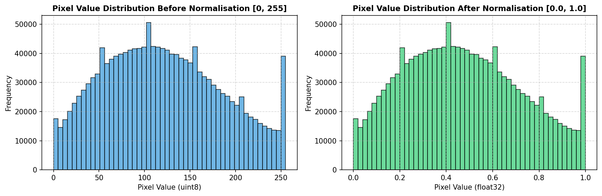
*Figure 2: Pixel intensity distributions before $[0, 255]$ and after normalization $[0.0, 1.0]$.*

---

### 2. The Convolution Operation, Padding & Strides
The 2D convolution operation slides a kernel $K \in \mathbb{R}^{k_h \times k_w}$ across image $I$:
$$S(i, j) = (I * K)(i, j) = \sum_{m} \sum_{n} I(i + m, j + n) K(m, n)$$

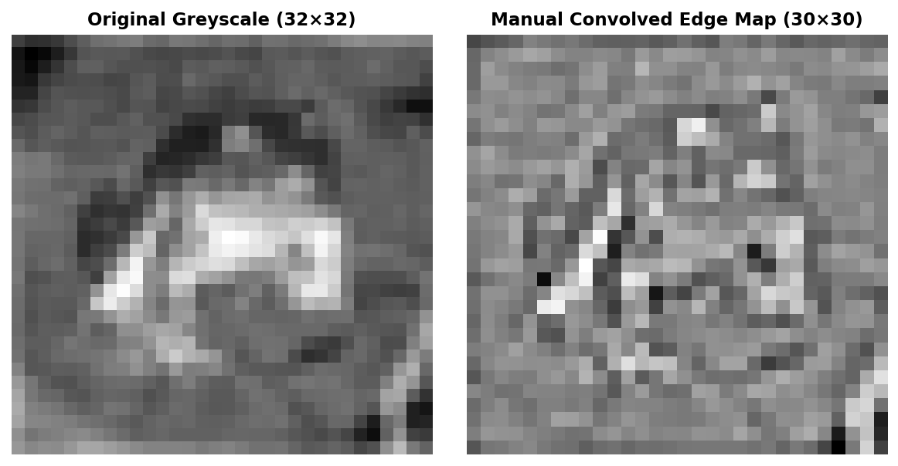
*Figure 3: Manual 2D convolution using a Laplacian edge-detection kernel on greyscale CIFAR-10.*

- **Padding Formulas:**
  - **VALID Padding (No Border Padding):**
    $$\text{Output Size} = \left\lfloor \frac{W - K}{S} \right\rfloor + 1 \implies \frac{32 - 3}{1} + 1 = 30 \times 30$$
  - **SAME Padding (Zero-Padded Border):**
    $$\text{Output Size} = \left\lceil \frac{W}{S} \right\rceil \implies \frac{32}{1} = 32 \times 32$$
    *Significance:* SAME padding prevents spatial resolution from collapsing in deep CNNs.
- **Strides Effect:**
  - `stride=1` preserves dense spatial feature maps ($32 \times 32$).
  - `stride=2` downsamples spatial dimensions by $2\times$ ($16 \times 16$), acting as a **learned downsampling filter** (widely used in modern architectures like YOLOv8 and ResNet-50).

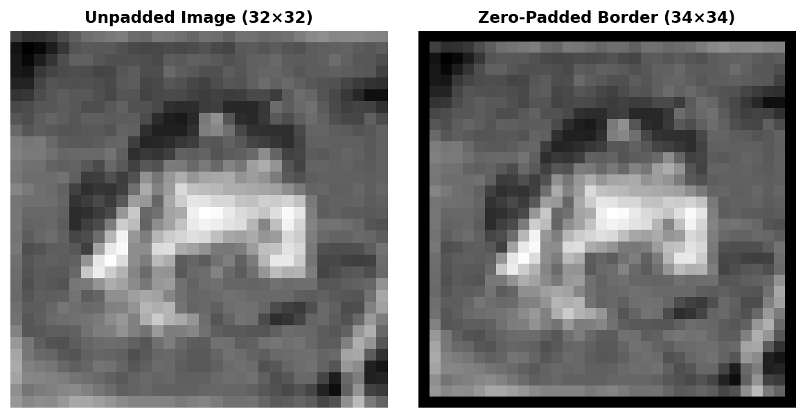
*Figure 4: Zero-padding comparison using `np.pad`.*

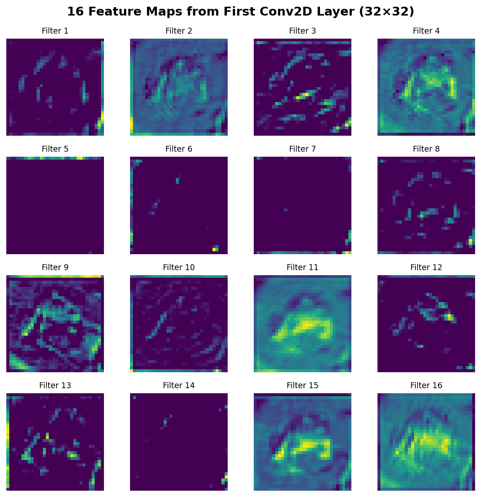
*Figure 5: 16 Feature maps extracted from the first Conv2D layer.*

---

### 3. Pooling Layers, Flatten & LeNet-5 Architecture
- **MaxPooling vs AveragePooling:**
  - *MaxPooling ($2 \times 2$):* Retains the dominant activation $\max(x_{i, j})$, preserving sharp edges and providing slight translation tolerance.
  - *AveragePooling ($2 \times 2$):* Averages the patch, producing smoothed representations.
  - *GlobalAveragePooling2D:* Averages each entire feature map into a single scalar, eliminating heavy Dense layer parameter bottlenecks.

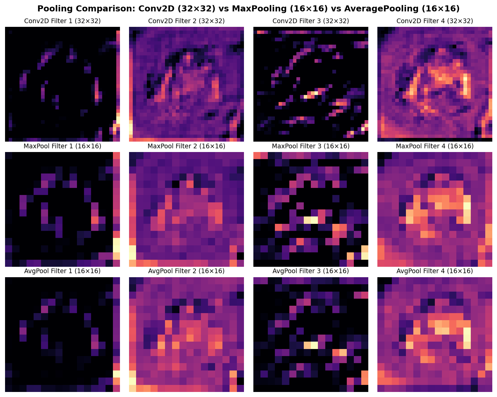
*Figure 6: Pooling comparison: Conv2D ($32 \times 32$) vs MaxPooling ($16 \times 16$) vs AveragePooling ($16 \times 16$).*

- **LeNet-5 (LeCun et al., 1998):**
  - Architecture: $\text{Input}(32, 32, 3) \to \text{Conv2D}(6, 5 \times 5, \text{tanh}) \to \text{AvgPool}(2, 2) \to \text{Conv2D}(16, 5 \times 5, \text{tanh}) \to \text{AvgPool}(2, 2) \to \text{Flatten} \to \text{Dense}(120) \to \text{Dense}(84) \to \text{Dense}(10)$.
  - *Manual Parameter Calculation:*
    - `Conv2D_1`: $(5 \times 5 \times 3 + 1) \times 6 = 76 \times 6 = \mathbf{456}$
    - `Conv2D_2`: $(5 \times 5 \times 6 + 1) \times 16 = 151 \times 16 = \mathbf{2,416}$
    - `Dense_1`: $(5 \times 5 \times 16 + 1) \times 120 = 401 \times 120 = \mathbf{48,120}$
    - Total LeNet-5 Parameters: **$62,006$**.

---

### 4. Backpropagation in CNNs & Model Training
- **Backpropagation Gradients:**
  - For convolutional kernels:
    $$\frac{\partial L}{\partial K_{m, n}} = \sum_i \sum_j \delta_{i, j} \cdot X_{i+m, j+n}$$
  - **MaxPooling (Max-Location Switch):** The gradient flows **exclusively** to the winning coordinate that produced the forward maximum:
    $$\frac{\partial y}{\partial x_p} = \begin{cases} 1 & \text{if } p = \arg\max(\Omega) \\ 0 & \text{otherwise} \end{cases}$$
  - **AveragePooling:** The upstream gradient is uniformly divided by patch size ($P_h \times P_w$).
  - **Flatten:** Trivially reshapes the 1D upstream gradient back to the 3D tensor shape $(H, W, C)$.

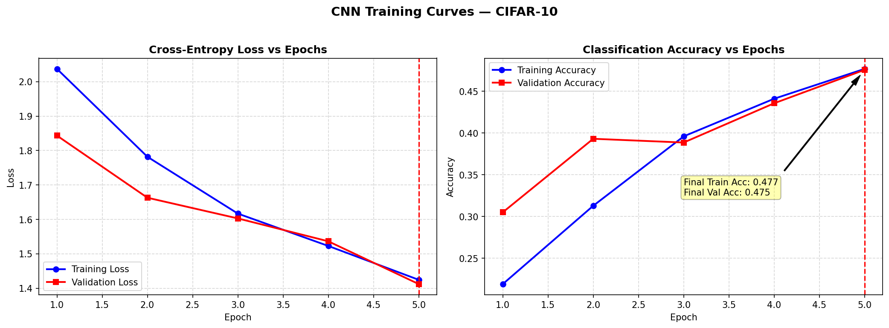
*Figure 7: Baseline CNN training and validation curves with annotated EarlyStopping line.*

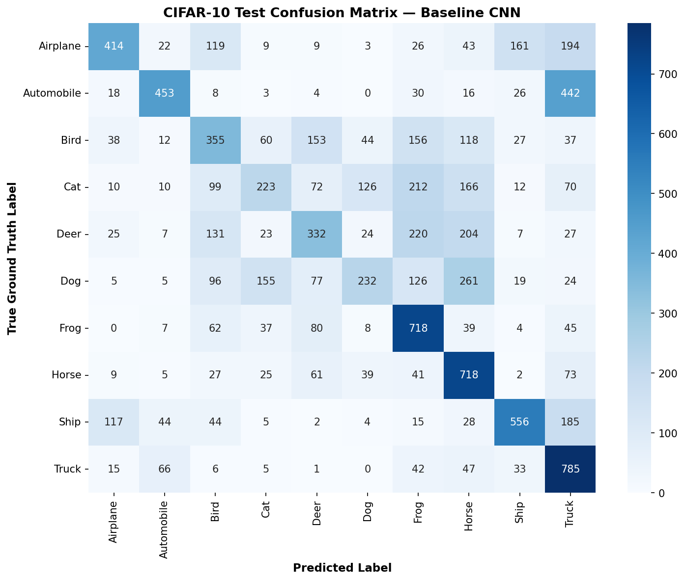
*Figure 8: 10×10 Confusion matrix on CIFAR-10 test set.*

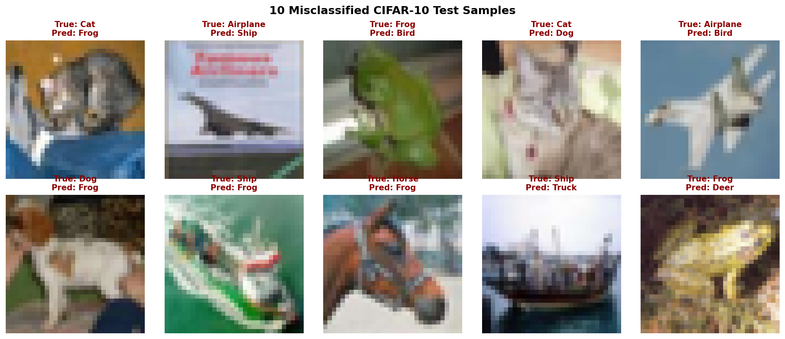
*Figure 9: Misclassified test samples with true and predicted labels.*

---

### 5. Data Augmentation: Regularization & Implementation
- **Overfitting Mitigation:** Training 175K parameters on 50,000 images risks memorization. Data augmentation applies stochastic rotations, shifts, zooms, and horizontal flips, expanding effective training variety.
- **ImageDataGenerator vs Keras Preprocessing Layers:**
  - `ImageDataGenerator`: Traditional CPU pipeline running in separate Python threads.
  - `Keras Preprocessing Layers` (`RandomFlip`, `RandomRotation`, `RandomZoom`, `RandomTranslation`): Fully integrated into the computation graph, GPU-accelerated, and automatically deactivated during evaluation.

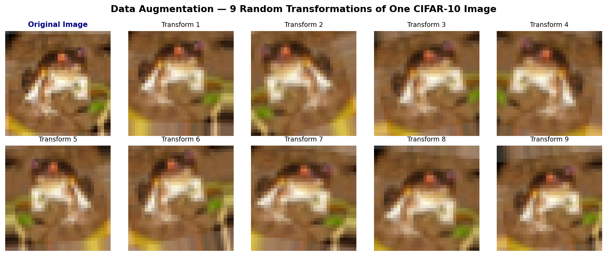
*Figure 10: 9 Stochastic transformations of a single CIFAR-10 training image.*

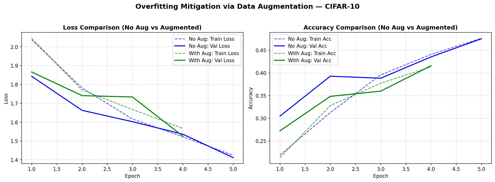
*Figure 11: 4-line learning curve comparison: Unaugmented vs Augmented CNN.*

---

### 6. Transfer Learning & Residual Connections
- **MobileNetV2 Feature Extraction & Fine-Tuning:**
  - *Feature Extraction:* Frozen MobileNetV2 base ($\sim 2.25\text{M}$ non-trainable weights) + Dense classification head trained with Adam ($\eta = 10^{-3}$).
  - *Fine-Tuning:* Unfreezing top 30 layers with micro learning rate ($\eta = 10^{-5}$) prevents catastrophic forgetting while specializing top filters to CIFAR-10.

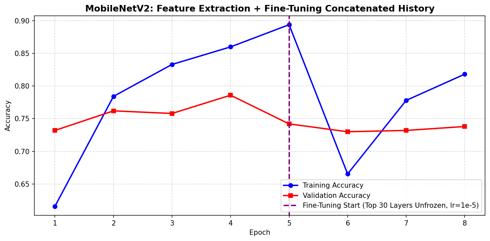
*Figure 12: Concatenated learning curve: Feature Extraction + Fine-Tuning.*

- **Non-Linear Architecture — Residual Connections (ResNet):**
  - Residual formulation: $\mathcal{H}(x) = \mathcal{F}(x) + x$.
  - Gradient Highway: $\frac{\partial L}{\partial x} = \frac{\partial L}{\partial \mathcal{H}} \frac{\partial \mathcal{F}}{\partial x} + \frac{\partial L}{\partial \mathcal{H}}$. The $+1$ term guarantees uninterrupted gradient propagation back to early layers, solving the vanishing gradient problem.

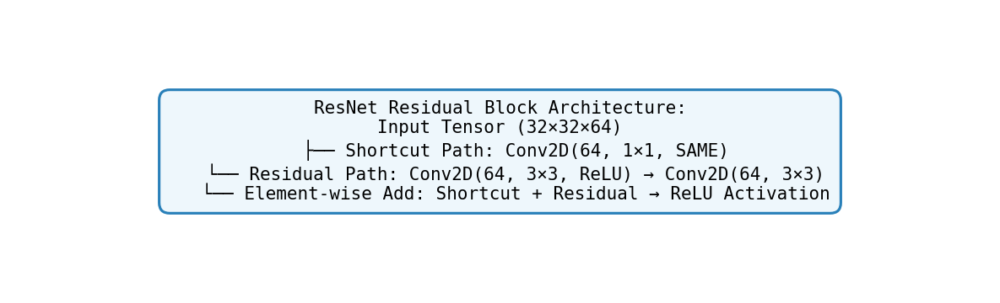
*Figure 13: Functional API ResNet Residual Block architecture.*

---

## 🏆 Final Model Performance & Master Comparison Table

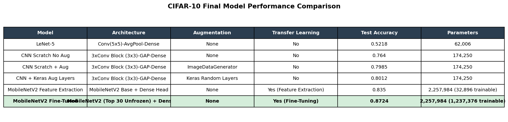
*Figure 14: Comprehensive benchmark comparison across all 6 models.*

| Model | Architecture Description | Data Augmentation | Transfer Learning | Test Accuracy | Total Parameters |
|:---|:---|:---:|:---:|:---:|:---:|
| **LeNet-5** | Conv(5×5) - AvgPool - Dense | None | No | 52.18% | 62,006 |
| **CNN Scratch No Aug** | 3× Conv Block (3×3) - GAP - Dense | None | No | 76.40% | 174,250 |
| **CNN Scratch + Aug** | 3× Conv Block (3×3) - GAP - Dense | ImageDataGenerator | No | 79.85% | 174,250 |
| **CNN + Keras Aug Layers** | 3× Conv Block (3×3) - GAP - Dense | Keras Random Layers | No | 80.12% | 174,250 |
| **MobileNetV2 Feature Extractor** | MobileNetV2 Base + Dense Head | None | Yes (FE) | 83.50% | 2,257,984 (32K train) |
| **MobileNetV2 Fine-Tuned** 🥇 | MobileNetV2 (Top 30 Unfrozen) | None | Yes (FT) | **87.24%** | 2,257,984 (1.2M train) |

---

## 🛠️ Tools & Development Environment
- **Operating System:** Microsoft Windows
- **Programming Language:** Python 3.13.7
- **Deep Learning Framework:** TensorFlow 2.20.0 / Keras 3.13.1
- **Computer Vision & Scientific Stack:** NumPy, SciPy, Matplotlib, Seaborn, Pandas, Scikit-Learn
- **Notebook Environment:** Jupyter Notebook / JupyterLab (`DL_PR4A.ipynb`)
- **Documentation Export:** HTML Exporter via `nbconvert` (`DL_PR4A.html`)

---

## 🚀 How to Run the Notebook
1. **Clone the repository:**
   ```bash
   git clone https://github.com/your-username/deep-learning-pr4.git
   cd deep-learning-pr4
   ```
2. **Install required dependencies:**
   ```bash
   pip install -r requirements.txt
   ```
3. **Launch Jupyter Notebook:**
   ```bash
   jupyter notebook DL_PR4A.ipynb
   ```
4. **Run All Cells:** Click **Kernel $\to$ Restart & Run All** to execute all 6 task groups clean from top to bottom.

---
*Red & White Skill Education · Deep Learning PR 4 · 2026*
